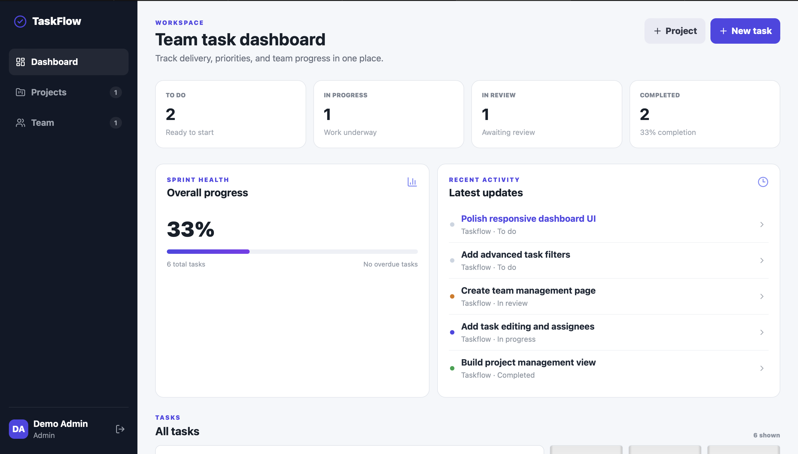
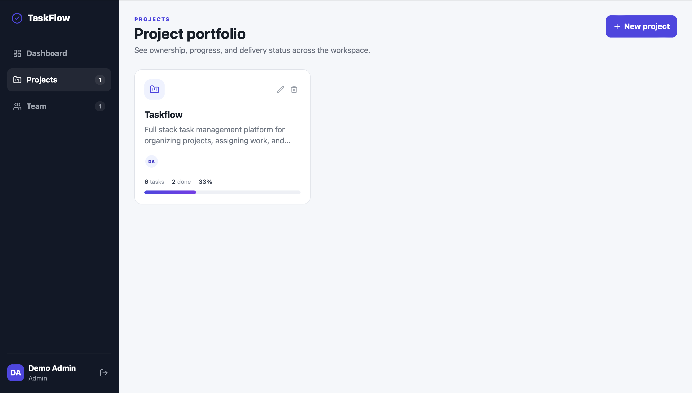

# TaskFlow

TaskFlow is a full-stack task management platform for organizing projects, assigning work, and tracking team progress.

## Live Demo

https://task-management-system-three-blush.vercel.app
## Screenshots

### Dashboard



### Projects


## Features

- User authentication with JWT
- Role-based access control
- Create and manage projects
- Create tasks with priority and status
- Update task status in real time
- Filter tasks by project and status
- Dashboard metrics for task progress
- Persistent MongoDB storage
- Responsive React interface
- Docker configuration
- GitHub Actions CI/CD workflow

## Tech Stack

### Frontend
- React
- Vite
- JavaScript
- CSS

### Backend
- Node.js
- Express.js
- JWT Authentication
- bcrypt

### Database
- MongoDB
- Mongoose
- MongoDB Atlas

### Deployment
- Vercel
- Render
- Docker
- GitHub Actions

## Architecture

```text
                    ┌─────────────────────┐
                    │     React + Vite    │
                    │      Frontend       │
                    │      Vercel         │
                    └─────────┬───────────┘
                              │
                              │ REST API
                              ▼
                    ┌─────────────────────┐
                    │  Node.js + Express  │
                    │       Backend       │
                    │       Render        │
                    └─────────┬───────────┘
                              │
                              │ Mongoose
                              ▼
                    ┌─────────────────────┐
                    │    MongoDB Atlas    │
                    │  Persistent Storage │
                    └─────────────────────┘

## Key Engineering Highlights

- JWT-based authentication with protected API routes
- Role-based access control for multi-user workflows
- Full CRUD support for projects and tasks
- Task assignment, status, priority, due dates, and filtering
- Project progress tracking and team visibility
- Persistent MongoDB Atlas storage
- Production frontend/backend separation using Vercel and Render
- Environment-based configuration for local and production deployments
- Docker support for containerized development
- GitHub Actions workflow for CI/CD
